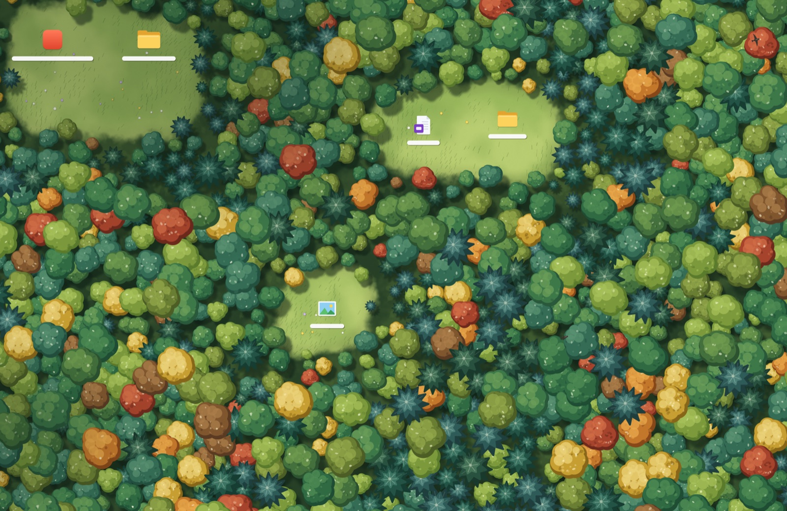

# Desktopia

**macOS 自适应动态壁纸：桌面图标会成为风景的一部分。** 图标挪动、增删时，海岸线、云朵、林间空地会跟着实时变化。

> **这是 fork 来的修改版。** Desktopia fork 自 [BLEZZ0102/Deskland](https://github.com/BLEZZ0102/Deskland)（Deskland Preview，GPL-3.0），把原来只能在 Windows 上运行的程序改成了 macOS 版，并新增了一个原创主题。它是**非官方**版本，与 Deskland 原作者没有关系，也没有得到原作者的认可或背书。Deskland 的名字和图标归原作者所有（见 [TRADEMARKS.md](TRADEMARKS.md)），所以这个修改版换了自己的名字。

*English: Desktopia is an unofficial macOS fork of [Deskland Preview](https://github.com/BLEZZ0102/Deskland) (GPL-3.0). It replaces the Windows host with a native macOS one and adds an original "Woodland" theme. Not affiliated with or endorsed by the Deskland authors.*



## 和原项目相比改了什么

- **新的 macOS 宿主**：原来的 Windows 宿主（C# + WebView2 + Win32）换成了 Swift + AppKit + WKWebView 写的 macOS 程序，代码在 `Sources/Desktopia/`。
- **主题页面原样复用**：`prototype/` 里的沙滩、草地主题和设置页与上游 `v0.1.3`（commit `9818b57`）完全一样，没有改动。界面上写给 Windows 的文案（"开机自动启动"、Windows 设置步骤）和产品名，在程序提供文件时替换，见 `MacText.swift`、`Overlay.swift`。
- **新增原创主题"林间"（Woodland）**：放在 `themes-mac/`。
- 上游的 Windows 宿主（`host/`）和安装包工具（`tools/`）原样保留，没有修改。上游原来的 README 在 [README.upstream.md](README.upstream.md)。

## 下载安装

1. 从 [Releases](../../releases) 下载 `Desktopia-<版本>.zip`，解压后把 `Desktopia.app` 拖进"应用程序"文件夹。
2. 这个 App 没有 Apple 开发者签名。第一次打开时，请在访达里**右键点 Desktopia → 打开**，再在弹窗里点"打开"；之后就能正常双击打开了。
3. macOS 会请求**辅助功能**权限（系统设置 → 隐私与安全性 → 辅助功能 → 打开 Desktopia）。Desktopia 靠这个权限从访达读取桌面图标的位置；不授权也能运行，但场景不会避开图标。授权后从菜单栏图标退出，再重新打开。

需要 macOS 13 或更高版本。只覆盖主显示器。

## 主题

| 主题 | 来源 |
| --- | --- |
| 沙滩、草地 | 上游 Deskland Preview 自带 |
| 林间（Woodland） | Desktopia 原创：俯视的森林，图标在林间空地上；一阵阵风吹过树梢，鸟从上空飞过，云影飘过。可调空地大小、秋色、风、云影、鸟的数量 |
| 其他 11 个（马尔代夫、森林、湖泊……） | 属于原作者付费的 Deskland 壁纸版（Windows），上游只公开了名字、简介和缩略图，没有页面代码。设置里仍显示为锁定，Desktopia 无法解锁 |

### 自己加主题

`themes-mac/` 和 `prototype/` 同级，程序读文件时先找 `themes-mac/`，再找 `prototype/`：

- `themes-mac/themes.json`：要加的主题条目，格式与上游相同，多一个 `after` 字段，表示在设置里排在哪个主题后面。
- `themes-mac/i18n/<语言>.json`：英文名称和参数说明（中文直接写在 themes.json 里）。
- 页面可以直接引用上游的 `share.js` 等文件。宿主协议和上游主题一样：页面加载后发 `ready`，然后会收到 `settings` / `icons` / `pause` / `reset` 消息。

浏览器预览（不用打包 App）：

```bash
python3 scripts/serve.py
```

然后打开 http://localhost:5179/woodland.html（可以拖示例图标）或 http://localhost:5179/settings.html。

## 从源码构建

需要 Xcode 或 Command Line Tools（Swift 5.9 以上）。

```bash
./scripts/build-app.sh
```

```bash
open build/Desktopia.app
```

> 脚本用的是本机临时签名（ad-hoc），每次重新构建后签名都会变，macOS 可能要求重新授权辅助功能。

开发时也可以直接运行：`swift run Desktopia`（会自动找到仓库里的 `prototype/`）。

### 命令行参数

| 参数 | 作用 |
| --- | --- |
| 无 | 启动壁纸并打开设置；已经在运行时打开设置 |
| `--autostart` | 后台启动，不弹设置窗口 |
| `--settings` | 让正在运行的实例打开设置 |
| `--exit` | 让正在运行的实例退出，桌面恢复系统壁纸 |
| `--debug-share image\|video` | 开发调试：不经过设置页直接生成分享图片 / 动画，结果写进日志 |

数据目录：`~/Library/Application Support/Desktopia/`（`settings.json`、`host.log`）。分享的图片和动画存到 `~/Pictures/Desktopia/`。分享图只用图标的位置，图标和文件名都画成示例图形，不会截取真实桌面。

## 实现对照

| 功能 | Windows 版（上游） | macOS 版（Desktopia） |
| --- | --- | --- |
| 挂到图标下面 | Progman / WorkerW 子窗口 | 无边框 `NSWindow`，层级为桌面层 +1（系统壁纸之上、访达图标层之下），所有桌面空间都显示，不接收鼠标 |
| 显示主题页面 | WebView2 | WKWebView。页面加载前注入一段兼容代码，把 `window.chrome.webview` 接到 `webkit.messageHandlers`，页面不用改 |
| 本地虚拟域名 | `https://app.local/` | `desktopia://app/`（`WKURLSchemeHandler`，支持 Range 请求，方便播放视频） |
| 读图标位置 | 跨进程读 `SysListView32` | 用辅助功能 API 读访达：`AXScrollArea "desktop"` → `AXGroup` → 每个图标一个 `AXImage`；文字标签按访达的图标大小 / 字号设置推算。桌面小组件也会被避开 |
| 最大化 / 全屏时暂停 | 检查前台窗口 | 窗口被完全挡住（`occlusionState`）、普通窗口铺满主屏可用区域、屏幕睡眠，或手动暂停 |
| 托盘 | `NotifyIcon` | 菜单栏图标 `NSStatusItem` |
| 开机自启 | 启动文件夹快捷方式 | 登录项 `SMAppService.mainApp` |
| 额外主题 | — | `Overlay.swift` 把 `themes-mac/` 叠在 `prototype/` 上，合并 `themes.json` 和 i18n |

## 已知限制

- 只覆盖主显示器（和原版一样）。
- 桌面开着"叠放"时，一组叠放算一个图标。
- 文字标签的范围是推算的：长文件名换行时可能和访达实际画的略有出入。
- 没有全局快捷键（原版的 Ctrl+Alt+H），菜单入口是菜单栏图标。

## 许可

GPL-3.0，见 [LICENSE](LICENSE)。原项目版权归 Deskland 作者所有；macOS 宿主、林间主题和其他修改见 [NOTICE](NOTICE)。

Deskland 的名字和图标不在 GPL 授权范围内（见 [TRADEMARKS.md](TRADEMARKS.md)）。本仓库只用这个名字注明来源。
